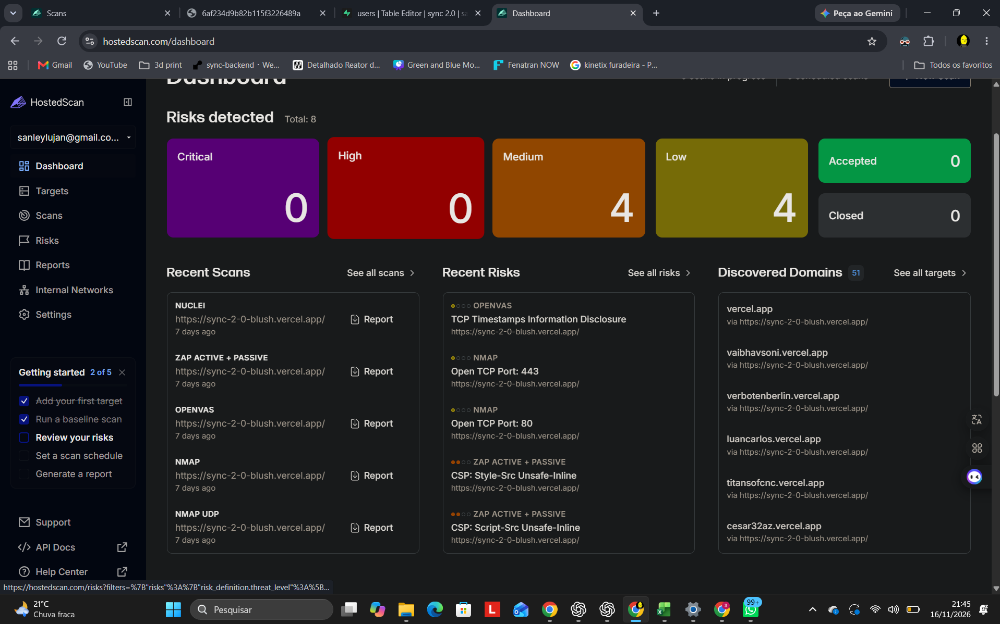

# SYNC — material para atualizar a documentação do TCC: segurança web

**Projeto:** SYNC-2.0 — aplicação social esportiva com recursos de geolocalização.

**Implementação e testes de referência:** 9 de novembro de 2026.

**Preparação deste documento para entrega no Git:** 16 de novembro de 2026.

**Finalidade:** fornecer um relato autossuficiente das alterações, das evidências e das limitações para a pessoa responsável pela documentação do TCC.

## 1. Instrução pronta para a IA que atualizará o TCC

Copie este arquivo inteiro e apresente à IA junto com a versão atual do TCC. Para incorporar a figura, envie também a imagem em `documentacao-tcc/figuras/hostedscan-dashboard-20261116.png`, ou use a [versão PDF com a figura incorporada](documentacao-tcc/TCC_ATUALIZACAO_SEGURANCA_WEB.pdf). Use a seguinte instrução:

> Atualize a documentação do TCC do projeto SYNC usando os fatos deste arquivo. Escreva em português acadêmico, em terceira pessoa, preservando a organização e o estilo do trabalho existente. Incorpore as informações às seções de implementação, segurança, testes e limitações, evitando repetir o mesmo conteúdo em capítulos diferentes. Diferencie as alterações implementadas, as validações locais, as observações anteriores ao deploy e os testes de produção ainda pendentes. Explique as decisões e suas razões, sem transformar o texto em um histórico da conversa com o assistente. Não invente resultados, métricas, referências bibliográficas, datas de acesso ou números de seções. Não afirme que os sete itens foram integralmente eliminados: permanece uma exceção de CSS no documento do botão Google, o teste autenticado no Render não foi realizado nessa avaliação e TCP timestamps pertencem à infraestrutura do provedor. Os números históricos dos testes descrevem a árvore de trabalho avaliada em 09/11/2026; não são uma contagem de testes criados por esta mudança. Ao final, informe quais trechos do TCC foram alterados e quais pendências precisam de evidência adicional.

> Considere também o PDF de base identificado na seção 2 e a captura do painel. Descreva o HostedScan como a plataforma utilizada para executar e reunir os resultados dos scanners, identificando separadamente as ferramentas. Inclua a figura com legenda e fonte, renumerando-a conforme o TCC. Não some contagens de ferramentas, ocorrências, logs, testes automatizados e cenários de navegador. Preserve as gravidades originais do scanner e distinga-as da prioridade de implementação. Não interprete a captura como uma nova varredura posterior às correções.

Este arquivo contém o contexto necessário para relatar esta intervenção e incorpora a síntese do PDF fornecido pelo responsável pelo projeto. O relatório técnico complementar no repositório é `SEGURANCA_WEB_20261109.md`.

## 2. Contexto e objetivo da intervenção

O frontend web do SYNC utiliza Expo, React e React Native Web, com hospedagem configurada na Vercel. A API utiliza NestJS e possui configuração de hospedagem no Render. A intervenção partiu de uma lista de sete recomendações de uma avaliação de segurança: restringir JavaScript inline, ampliar a cobertura autenticada, restringir CSS inline, limitar origens de imagens, revisar o CORS do frontend, conferir a consistência dos cabeçalhos HTTPS e registrar o alerta de TCP timestamps como responsabilidade da infraestrutura.

O objetivo foi reduzir permissões genéricas de carregamento e execução no navegador, preservar os recursos legítimos da aplicação e criar meios de verificar a configuração. Os testes e as observações públicas disponíveis não demonstram, por si, a segurança integral do sistema.

Não foram implementados novos requisitos funcionais de negócio, alterações do modelo de dados ou migrações do banco nesta intervenção. A validação de segurança no navegador é complementar aos controles de autenticação e autorização da API.

### 2.1. Uso do HostedScan na avaliação externa

O **HostedScan foi utilizado para executar as varreduras externas e concentrar seus resultados em um painel**, conforme a confirmação do responsável pelo projeto, a captura apresentada abaixo e o PDF de base. Ele deve ser descrito como a plataforma de execução, consulta e organização dos resultados, identificando o scanner responsável por cada registro. A documentação oficial apresenta a integração de ferramentas de análise de aplicações web, rede, portas e TLS, além de consulta a relatórios. [HostedScan — plataforma](https://hostedscan.com/platform), [HostedScan — scanners integrados](https://hostedscan.com/compare).

No contexto do SYNC, os materiais registram Nuclei, OWASP ZAP ativo/passivo, OpenVAS, Nmap TCP, Nmap UDP e SSLyze. A captura mostra cinco desses tipos na área visível de scans recentes; a referência ao SSLyze vem do PDF. A disponibilidade de varreduras autenticadas na plataforma não comprova que a autenticação tenha sido configurada ou usada nesses scans. A cobertura após login continua não demonstrada pela documentação recebida. [HostedScan — varreduras autenticadas](https://hostedscan.com/authenticated-web-app-vulnerability-scan).

Não foram confirmados plano contratado, agendamento recorrente, integração do HostedScan com o CI, uso da API do serviço ou monitoramento contínuo. O job de CI implementado no projeto executa verificações próprias; não foi implementada uma integração com HostedScan.

### 2.2. Figura: painel do HostedScan utilizado no projeto

**Figura 1 — Painel do HostedScan utilizado na avaliação externa do SYNC.** Fonte: captura de tela fornecida pelo responsável pelo projeto, com data de 16/11/2026 exibida no sistema. Arquivo original preservado, sem edição.

A figura mostra o alvo `https://sync-2-0-blush.vercel.app/`, a lista de scans recentes e um total consolidado de **8 riscos: 0 críticos, 0 altos, 4 médios e 4 baixos**. Os campos `Accepted` e `Closed` exibem zero. Na área de riscos recentes aparecem TCP timestamps, portas TCP 80/443 e alertas relativos a CSS e JavaScript inline na CSP. Esses elementos comprovam o registro desses resultados na interface, não a exploração de uma falha ou a validação de uma correção.

Os scans aparecem como realizados há sete dias, compatível com a data de 09/11/2026 documentada no PDF. A data da captura não deve ser usada como data de nova execução. Os 51 domínios em `Discovered Domains` são uma contagem de descoberta da plataforma; nomes de terceiros exibidos sob `vercel.app` não devem ser atribuídos ao SYNC nem incorporados ao escopo sem validação. O zero em `Closed` não comprova que o código permaneça sem correção: trata-se do estado de tratamento registrado no painel capturado.

### 2.3. Identificação e alcance do PDF adicional

O documento **`SYNC_Relatorio_Detalhado_Testes_e_Achados.pdf`**, com sete páginas, apresenta scans de **09/11/2026** e data de emissão de **16/11/2026**. Foram lidas as sete páginas, incluindo tabelas, notas e limites de cobertura. Sua elaboração consistiu em análise dos materiais fornecidos: o próprio relatório informa que não executou novos scans, não acessou o código e não validou a configuração atual da aplicação.

O PDF é uma fonte documental adicional para o diagnóstico anterior às mudanças. Ele resume relatórios e capturas identificados internamente como S1 a S7: ZAP, OpenVAS, Nmap TCP, resumo de segurança, dashboard, lista de scans e retorno preliminar de Pentest-Tools Light. Esses documentos originais não foram auditados novamente nesta atualização; os dados abaixo são atribuídos ao relatório detalhado fornecido. As páginas citadas nesta seção referem-se ao PDF de sete páginas, não à paginação dos relatórios originais.

**Identificação da cópia consultada:** 116.585 bytes; SHA-256 `1f7151e888e01364ebe7dfd78fd2e1316c8e3f04e5ecff754a8079993faae0db`. O hash identifica o arquivo utilizado; não atesta sua autoria nem a correção dos resultados. O PDF original permaneceu como arquivo fornecido pelo responsável; esta entrega ao Git contém sua síntese e identificação, além da captura solicitada.

### 2.4. Ferramentas e resultados descritos pelo relatório externo

| Ferramenta ou registro | Resultado descrito no PDF | Interpretação e limite |
|---|---|---|
| Painel consolidado do HostedScan | 0 críticos, 0 altos, 4 médios e 4 baixos; 0 aceitos e 0 fechados (pp. 1 e 7). | É a contagem consolidada apresentada pela plataforma. A regra exata de agrupamento não foi confirmada; não somar esse total às ocorrências dos scanners. |
| OWASP ZAP 2.17.0, ativo/passivo | 4 tipos médios, 1 baixo e 3 informativos, a partir do relatório original de 16 páginas (p. 1). | Os alertas de CSP e CORS decorrem da análise passiva de cabeçalhos, embora o conjunto esteja identificado como ativo/passivo. Não comprovam exploração de XSS ou acesso indevido. |
| OpenVAS | 57 registros apresentados: 2 ocorrências baixas de TCP timestamps e 55 `Log`, em dois IPs (p. 5). | Havia 59 registros antes do filtro de QoD mínimo de 70%; os dois excluídos não foram analisados. `Log` não equivale a vulnerabilidade. QoD descreve a qualidade da detecção, não a chance de invasão. |
| Nmap TCP 7.93 | Varredura de conexão `-sT`, intervalo reportado de portas 0 a 65535, duração de 88 segundos, host `216.198.79.3`; portas 80 e 443 abertas e demais sondadas filtradas (p. 4). | Portas web abertas são compatíveis com o serviço esperado. Estado filtrado não significa fechado. O resultado não descreve as portas internas do Render ou do Supabase. |
| Nuclei, Nmap UDP e SSLyze | Sem riscos sinalizados no painel de scans descrito pelo PDF; relatórios individuais não fornecidos (pp. 1 e 6). | O status no painel não permite auditar o alcance de cada teste nem demonstrar ausência de vulnerabilidades. |
| Pentest-Tools Light, verificação preliminar | Retorno transcrito com 2 baixos e 2 informativos, 40 testes e duração de 21 segundos (p. 4). | Não é um resultado do HostedScan. O próprio modo Light informou não testar SQL injection, XSS, command injection ou XXE. Esses 40 testes não se somam aos testes de software do projeto. |

Os resultados TLS resumidos no PDF vêm do OpenVAS: identificação de TLS 1.2/1.3 e Perfect Forward Secrecy, com ausência reportada de cifras Weak, Null e Anonymous nas verificações descritas (p. 5). O nome `Medium Cipher Suites` aparece em um registro classificado como `Log`; não deve ser contado como alerta médio. Esses dados não representam mudanças de TLS implementadas no código nem uma inspeção atual do ambiente.

### 2.5. Evidências dos achados e relação com as alterações

| Evidência no PDF | Gravidade atribuída pela ferramenta e ocorrências | Relação com o trabalho implementado |
|---|---|---|
| `script-src` com `unsafe-inline`, raiz e `/index.html` (p. 2, §2.1). | Médio no ZAP; regra 10055, subtipo 10055-5; 2 ocorrências. | Origem do item 1: política restrita, scripts externos e bloqueio de handlers. |
| `style-src` com `unsafe-inline` e bloco legítimo `expo-reset` (p. 2, §2.2). | Médio no ZAP; regra 10055, subtipo 10055-6; 2 ocorrências. | Origem do item 3: adaptação de estilos e fontes, com exceção explícita para o documento do botão Google. |
| `img-src 'self' data: blob: https:` (p. 2, §2.3). | Médio no ZAP; regra 10055, subtipo 10055-4; 2 ocorrências. | Origem do item 4: substituição da permissão HTTPS genérica pela lista de origens necessárias. |
| `Access-Control-Allow-Origin: *` na raiz, `apple-touch-icon.png`, `favicon.ico`, `favicon.png` e `manifest.json` (p. 3, §3.1). | Médio no ZAP; regra 10098; 5 ocorrências. | Origem do item 5: revisão do CORS do frontend. O impacto foi contextualizado por se tratar dos recursos públicos descritos; o diagnóstico não demonstrou vazamento de dados privados. |
| HSTS presente no 200 e ausente em amostras 304 e desafio 403 com `X-Vercel-Mitigated: challenge` (p. 3, §3.2). | Baixo no ZAP, com 3 ocorrências; detecção e ausência também aparecem como `Log` no OpenVAS. | Origem do item 6: comparar respostas normais, de cache e de erro, distinguindo aplicação e plataforma. A ausência posterior não revoga uma política HSTS já recebida. |
| TCP timestamps em `64.29.17.3` e `216.198.79.3` (p. 3, §3.3). | Baixo no OpenVAS; CVSS 2,6 e QoD 80%, conforme o PDF; 2 ocorrências do mesmo tipo. | Origem do item 7: registro de infraestrutura do provedor. Essa pontuação pertence ao achado reportado, não é uma nota CVSS do SYNC. |

**Prioridade de implementação e gravidade são medidas distintas.** As prioridades alta, média e baixa usadas para organizar as correções não reclassificam os alertas do scanner. Em particular, a alta prioridade de restringir JavaScript não transforma o alerta médio do ZAP em vulnerabilidade alta. O relatório não demonstra invasão, exploração de XSS ou vazamento de dados; tampouco prova a inexistência dessas falhas.

### 2.6. Informativos e limites que afetam a conclusão

O PDF registra três informativos do ZAP (p. 4): preferência de tema `@sync:theme-mode=dark` em localStorage, revisão das diretivas de cache e conteúdo recuperado de cache. A chave de tema observada não demonstra armazenamento de senha ou documento e não permite concluir nada sobre todas as outras chaves. Cache de recursos públicos não comprova reutilização de dados privados entre contas. Inventário de banners, CPE, serviços e tentativas de identificar o sistema operacional também não deve ser convertido automaticamente em vulnerabilidades do app.

O relatório explicita que o OpenVAS estava com a varredura genérica de aplicações web desabilitada na configuração do scanner. Parte das requisições recebeu desafio 403 da Vercel, e o ZAP documentado lista apenas o domínio do frontend. A cobertura após login, a API no Render e as regras do Supabase não estão demonstradas pelos scans fornecidos. A presença de regras para XSS, SQL injection, command injection ou XXE na lista `Passing Rules` não comprova cobertura de todas as funcionalidades (p. 6).

A validação de autorização entre contas, funções administrativas, RLS e proteção de segredos é apresentada no PDF como recomendação preventiva de prioridade muito alta, e não como falha comprovada. Nenhuma correção de RLS ou de segredo foi implementada nesta intervenção. O relatório também contextualiza cabeçalhos antigos ou opcionais; não foi adotada a aplicação indiscriminada de todos os itens descritos por scanners como cabeçalhos ausentes.

Para o TCC, preservar quatro registros distintos: scans externos de 09/11 resumidos no PDF emitido em 16/11; implementação e testes locais de 09/11; validação do conteúdo selecionado para o commit em 16/11; e atualização documental com o PDF e a figura. A elaboração desta documentação não executou uma nova campanha de scans e não demonstrou queda dos números do painel após as correções.

## 3. Tratamento dos sete itens

| Item | Situação anterior ou recomendação | Alteração ou tratamento | Limite da conclusão |
|---|---|---|---|
| 1 — JavaScript na CSP | A política do frontend e a configuração de produção do Helmet admitiam JavaScript inline por meio de `unsafe-inline`. | A página principal passou a utilizar `script-src 'self'` e `script-src-attr 'none'`. A permissão geral de JavaScript inline também foi retirada da API. O pós-build externaliza scripts executáveis presentes no HTML gerado. | Foram testados o bloqueio de scripts e handlers inline e o carregamento da biblioteca Google. O login com consentimento de uma conta Google real continua dependente da validação de produção. |
| 2 — Cobertura dos testes | Era necessário alcançar recursos posteriores ao login e a API no Render. | Foram acrescentados cenários de navegador com sessão e respostas de API fictícias, teste HTTP dos cabeçalhos e um roteiro executável para verificar o ambiente publicado. A integração contínua passou a incluir os testes de CSP. | Navegação autenticada com fixtures não equivale a teste autenticado no Render. A avaliação pública verificou disponibilidade, CORS e rejeição de sessões ausentes ou inválidas. |
| 3 — CSS inline | Retirar `unsafe-inline` diretamente impediria estilos legítimos de bibliotecas e do próprio app. | Foram adaptados estilos auxiliares, fontes, filtros de acessibilidade e marcadores de mapa. A página principal deixou de permitir CSS inline arbitrário. | A biblioteca Google exige uma exceção de CSS, restrita a `/google-signin.html`. Portanto, não foi eliminado CSS inline de todos os documentos hospedados. |
| 4 — Origens de imagens | A diretiva `img-src` permitia qualquer origem HTTPS por meio de `https:`. | A autorização ampla foi substituída por uma lista de origens de uploads do Render, Unsplash, avatares Google, mapas CARTO/OSM e imagens versionadas do Leaflet, mantendo também recursos locais, `data:` e `blob:`. | Imagens de outros domínios passam a ser bloqueadas e exigem revisão explícita da lista. Não houve inventário completo das URLs existentes no banco de produção. |
| 5 — CORS do frontend | Recursos públicos publicados respondiam com `Access-Control-Allow-Origin: *`. | A configuração do frontend passou a declarar sua origem de produção explicitamente. A API mantém a configuração de origens exatas obtidas de `FRONTEND_URL`. | A sobreposição do cabeçalho padrão da plataforma deve ser conferida no deploy. O wildcard observado em recursos públicos não demonstrou vazamento de dados privados. |
| 6 — Cabeçalhos HTTPS | Era necessário verificar respostas normais, de cache e de erro, além de evitar divergências entre configurações. | Os dois arquivos da Vercel passaram a compartilhar uma política gerada e verificada. No backend, os cabeçalhos foram configurados antes dos parsers do corpo, cobrindo também erros de JSON. O HSTS da API foi ajustado para um ano, sem declarar preload. | A verificação local e a inspeção pública são amostras. Devem ser repetidas após a publicação; páginas e falhas geradas pelo provedor podem exigir análise específica. |
| 7 — TCP timestamps | O achado foi atribuído à infraestrutura que atende o frontend, conforme o domínio e os banners informados na avaliação. | Foi registrado como responsabilidade do provedor, sem alteração no código do app ou no sistema operacional de servidores. | Não houve nova captura ou análise de pacotes TCP. O alerta não deve ser descrito como corrigido pelo aplicativo. |

## 4. Decisões técnicas e justificativas

### 4.1. Política centralizada e build verificável

A política do frontend foi centralizada em `mobile/scripts/security-policy.cjs`. O script `sync-security-config.cjs` sincroniza os cabeçalhos de `vercel.json` e `mobile/vercel.json`. Seu modo `--check` verifica divergências e pode interromper o build se uma configuração estiver desatualizada.

O comando `npm run build:web` executa essa verificação, exporta o aplicativo Expo para web e aplica o pós-processamento. O pós-build transforma blocos de script executável e folhas de estilo do HTML em arquivos externos com nomes derivados do hash do conteúdo. Também rejeita handlers inline, atributos de estilo no HTML inicial e URLs `javascript:` identificados pelo verificador. Falhas desse processamento deixam de ser apenas avisos e passam a impedir a conclusão do build.

Esse processamento atua sobre o HTML gerado pelo projeto; não constitui um sanitizador geral de HTML fornecido por usuários.

### 4.2. Compatibilidade dos estilos de Expo e React Native Web

O React Native Web cria uma folha inicialmente vazia e acrescenta regras por meio da CSS Object Model, com código JavaScript autorizado. A CSP admite o hash do conteúdo vazio dessa folha; isso não autoriza qualquer texto CSS inline. O Expo Image possui uma folha fixa de transições, cujo conteúdo exato recebe um hash específico. Atualizações dessa dependência devem passar novamente pela verificação e, quando necessário, pela regeneração da configuração.

O carregamento web de fontes passou a utilizar a API `FontFace`. Os estilos de campos e os ajustes de Leaflet passaram a usar inserção de regras por CSSOM. Filtros de acessibilidade são aplicados por propriedades de estilo manipuladas pelo código do app. Marcadores personalizados do mapa passaram a ser renderizados pelo React no DOM, em vez da inserção de strings HTML contendo atributos `style`.

Essas medidas preservam os caminhos de atualização de estilo usados pelo código confiável sem liberar CSS inline arbitrário na página principal. O caminho legado de importação do mapa web também passou a reutilizar a implementação adaptada.

### 4.3. Exceção de CSS para Google Identity Services

O teste com a biblioteca real do Google mostrou que a renderização do botão injeta uma folha de estilos e atributos inline. Para manter a política restrita do documento principal, o botão foi movido para um iframe de mesma origem, servido por `/google-signin.html`, com JavaScript e CSS próprios.

Somente esse documento admite `unsafe-inline` em `style-src`. JavaScript inline permanece bloqueado nele. A política principal exclui esse caminho, e o documento do botão recebe cabeçalhos próprios que permitem seu enquadramento pela mesma origem. Essa separação limita a exceção de CSS a um documento; não deve ser apresentada como isolamento entre origens ou como sandbox completo contra código JavaScript da biblioteca.

O iframe envia a credencial Google ao documento pai com `postMessage`, usando uma origem de destino explícita. O componente pai verifica `origin` e `source` antes de encaminhar a credencial à API. A validação criptográfica do ID token continua sendo responsabilidade do backend e não foi substituída por essa comunicação no navegador. O iframe não recebe o token de sessão Sync como parte desse protocolo. Por ser da mesma origem, essa descrição não significa que exista isolamento geral do armazenamento do navegador.

O service worker recebeu nova versão e deixa os arquivos dessa integração fora de sua interceptação de cache, para evitar a reutilização de um protocolo antigo após deploys. O documento do botão também recebe `Cache-Control: no-store`.

### 4.4. Cabeçalhos e erros HTTP da API

A configuração de segurança HTTP do NestJS foi extraída para uma função reutilizável, empregada pelo servidor principal e pelo teste de integração. Os cabeçalhos são instalados antes dos parsers de JSON e de formulário. Dessa maneira, uma falha de leitura do corpo também pode retornar as proteções configuradas.

O Helmet mantém políticas de conteúdo e proteção de enquadramento. Para o Swagger, os estilos estáticos necessários são autorizados por hashes específicos, incluindo uma autorização restrita para o atributo de estilo do sprite SVG. O HSTS de produção passou a declarar `max-age=31536000` e `includeSubDomains`; não foi afirmada inscrição em lista de preload.

## 5. Evidências e alcance dos testes do código e da interface

Os números desta seção referem-se aos testes do projeto, separados dos alertas e dos registros de scanners descritos na seção 2. Não representam reexecução de HostedScan, ZAP, OpenVAS, Nmap, Nuclei ou SSLyze.

Os resultados históricos de 09/11/2026 foram obtidos na árvore de trabalho local então disponível:

| Grupo | Resultado registrado | O que foi exercitado |
|---|---|---|
| Backend existente | 151 testes aprovados | Suítes que já estavam disponíveis na árvore de trabalho; não são 151 testes novos desta intervenção. |
| Novo teste HTTP | 1 teste aprovado | Aplicação Nest isolada, sem banco, com respostas HTTP reais 200, 304, 400 e 404, usando a configuração de cabeçalhos do servidor. |
| Cliente | 98 testes aprovados em 26 suítes | Suítes do cliente, incluindo a atualização dos testes de cache do service worker. |
| Regressão de perfis | 11 cenários aprovados | Temas, tamanhos de tela, galeria e cenários de falha, com a CSP aplicada. |
| Login, mapa e CSP no navegador | 8 cenários aprovados | Quatro totalmente locais e quatro carregando a biblioteca real do Google; login e respostas da API continuaram sintéticos. |
| Compilação e tipos | Aprovados | Typecheck de cliente e backend, exportação web Expo e build Nest. |

A soma histórica corresponde a 250 testes automatizados do backend/cliente e 19 cenários de navegador. Esses dois grupos foram contados separadamente. A quantidade não expressa percentual de cobertura, pontuação de segurança ou quantidade de vulnerabilidades eliminadas. A árvore local também continha alterações de outras tarefas; o total histórico não deve ser atribuído automaticamente apenas ao commit de segurança.

Na preparação para envio ao Git, em **16/11/2026**, foi exportada uma cópia com o conteúdo exato selecionado para o commit, sem as alterações locais das outras tarefas. Nessa cópia, passaram **139 testes do backend em 27 suítes e 98 testes do cliente em 26 suítes**, totalizando **237 testes**. Também passaram as checagens de tipos dos dois projetos e a verificação de consistência dos cabeçalhos. A diferença em relação ao total histórico decorre do escopo distinto da árvore avaliada; não representa perda de testes desta intervenção. Os resultados de builds e dos 19 cenários de navegador apresentados acima continuam identificados como evidências de 09/11/2026.

Nos cenários de navegador foram testados cinco bloqueios: script inline, handler de evento inline, folha CSS inline arbitrária, atributo de estilo injetado e imagem de origem não permitida. Também foi verificado que uma mensagem de outra janela não produz uma chamada de autenticação Google. Mapas, marcadores, fontes e navegação foram exercitados com dados fictícios, incluindo localização e tiles sintéticos.

Os testes com a biblioteca real do Google comprovaram seu carregamento e a renderização do botão no cenário avaliado. Não houve consentimento ou autenticação de uma pessoa real no Google. O teste de comunicação da credencial com a API usou uma credencial fictícia e uma resposta controlada.

A inspeção pública anterior ao deploy verificou a disponibilidade da API, o CORS para origem confiável e não confiável e a rejeição de acessos sem sessão ou com token inválido em perfil, feed, histórico de atividades, grupos e conversas. As respostas de frontend observadas ainda continham a política anterior. Isso é uma fotografia anterior à publicação das mudanças, não um resultado do ambiente já atualizado.

Foram observadas respostas de cache `HIT`, uma resposta condicional 304 e uma resposta 404. A omissão de cabeçalhos em um 304 isolado não foi tratada como prova automática de falha: o verificador considera os cabeçalhos da representação 200 armazenada. A página 404 observada também continha os cabeçalhos configurados.

## 6. Automação e manutenção

A configuração de integração contínua recebeu um job para exportar o aplicativo e executar os testes de CSP, login e navegação autenticada com fixtures. A regressão de perfis é executada com os cabeçalhos aplicados. O CI também verifica a consistência dos dois arquivos de configuração da Vercel e prevê o armazenamento das evidências web como artefatos.

Foram disponibilizados os comandos `build:web`, `test:security:web` e `test:security:live` no pacote do cliente. O verificador do ambiente publicado registra cabeçalhos, status e limitações; ele não salva credenciais, tokens ou corpos de respostas autenticadas. Para testar endpoints autenticados, exige que uma sessão de conta de teste seja configurada localmente em `SECURITY_TEST_TOKEN`. Uma execução incompleta retorna código de saída diferente de zero.

Configurar um job de CI não comprova sua execução bem-sucedida no GitHub. Fazer push no Git também não comprova a publicação bem-sucedida na Vercel ou no Render. Esses resultados precisam ser associados ao commit e aos registros das respectivas plataformas.

## 7. Limitações e pendências que devem permanecer no TCC

1. Validar o login com conta Google real no domínio publicado, incluindo consentimento, retorno ao app e encerramento da sessão.
2. Executar os testes com uma conta de teste autenticada no Render. O uso de fixtures no navegador não verifica esse ambiente.
3. Conferir os cabeçalhos efetivos após o deploy, inclusive a exceção de `/google-signin.html`, os recursos de cache e as respostas de erro da plataforma.
4. Manter explícita a exceção de CSS inline no documento do botão Google. Uma exigência de eliminação total dessa permissão ainda não foi atendida.
5. Ampliar uma avaliação futura para autorização entre duas contas, acesso a objetos, operações de escrita, uploads e WebSocket. Esta intervenção não é uma auditoria autenticada completa.
6. Revalidar recursos externos e imagens após alterações de domínios ou dependências. O widget externo VLibras já não estava autorizado na política anterior e sua integração não foi corrigida neste escopo.
7. Tratar TCP timestamps com o provedor, apresentando a evidência original. Não registrar como alteração do código nem como vulnerabilidade eliminada pelo app.
8. Em nova avaliação externa, comprovar a autenticação efetiva e registrar as rotas alcançadas, os desafios 403 e o escopo da API. Repetir os scanners relevantes para comparar resultados antes/depois com critérios equivalentes. Não usar a figura do painel como evidência de reteste após correção.

## 8. Texto-base que pode ser adaptado ao capítulo de implementação

> A avaliação externa do SYNC utilizou a plataforma HostedScan para executar e reunir resultados de ferramentas de análise da aplicação web e da infraestrutura exposta. Os materiais documentam o uso de OWASP ZAP, OpenVAS, Nuclei, Nmap TCP/UDP e SSLyze, com níveis distintos de detalhamento disponíveis. A captura do painel apresenta oito riscos consolidados, distribuídos em quatro médios e quatro baixos, sem registros altos ou críticos. Essa classificação descreve os achados apresentados pela plataforma, não uma certificação da segurança do sistema.
>
> O relatório detalhado, emitido em 16 de novembro de 2026 a partir dos scans de 9 de novembro, identificou permissões amplas na Content Security Policy e no CORS de recursos públicos, além de diferenças de HSTS em respostas específicas e informações de infraestrutura. As evidências de cabeçalhos foram interpretadas considerando o contexto de uso: uma política permissiva não demonstrou exploração de XSS, o compartilhamento de ícones e manifesto não comprovou vazamento de informações privadas e a abertura das portas HTTP/HTTPS foi tratada como parte da exposição esperada do serviço. As limitações de cobertura, incluindo desafios da plataforma e ausência de comprovação de autenticação no scanner, foram preservadas na análise.
>
> A aplicação web passou por uma etapa de revisão das políticas de carregamento e execução de conteúdo. A Content Security Policy do documento principal foi restringida para permitir a execução de scripts da própria origem e bloquear handlers de evento inline. O processo de build passou a externalizar scripts e folhas de estilo presentes no HTML gerado, além de interromper sua execução quando identificadas estruturas incompatíveis com a política. Os cabeçalhos do frontend foram centralizados em uma configuração compartilhada, com verificação de consistência entre os arquivos de implantação.
>
> A adoção de uma política mais restritiva exigiu adaptações nas bibliotecas de interface. As regras dinâmicas de estilo passaram a utilizar mecanismos compatíveis com a CSS Object Model, enquanto o carregamento de fontes no navegador foi ajustado para a API FontFace. Também foram revistos os estilos auxiliares de campos, os filtros de acessibilidade e a renderização de marcadores do mapa. A permissão genérica para imagens de qualquer origem HTTPS foi substituída por uma lista explícita de origens utilizadas pela aplicação, e o CORS do frontend recebeu uma origem de produção específica.
>
> A biblioteca de autenticação do Google exigiu um tratamento de compatibilidade, pois sua interface injeta estilos inline. O botão foi transferido para um documento de mesma origem com política própria, mantendo essa permissão de CSS apenas no documento auxiliar. A comunicação da credencial com a aplicação utiliza postMessage com verificação da origem e da janela emissora. Essa adaptação não substitui a validação do ID token pela API nem representa isolamento completo entre origens.
>
> A verificação combinou testes automatizados, cenários de navegador com dados fictícios e inspeções HTTP públicas. Foram exercitados bloqueios de conteúdo inline e de imagens não autorizadas, assim como fluxos de interface e respostas HTTP de sucesso, cache e erro. Os resultados locais indicam o funcionamento dos controles nos cenários avaliados. Permanecem necessárias a validação autenticada no ambiente do Render e a confirmação do fluxo de consentimento Google com conta real após a publicação. O alerta de TCP timestamps foi registrado como item de infraestrutura do provedor, sem alteração do código do aplicativo.

## 9. Mapa dos arquivos para rastreabilidade

| Área | Arquivos principais no repositório |
|---|---|
| Política e implantação web | `mobile/scripts/security-policy.cjs`, `mobile/scripts/sync-security-config.cjs`, `vercel.json`, `mobile/vercel.json` |
| Exportação web | `mobile/scripts/postbuild.js`, `mobile/package.json` |
| Segurança HTTP da API | `backend/src/main.ts`, `backend/src/common/security/http-security.ts`, `backend/src/common/security/http-security.spec.ts` |
| Autenticação Google no navegador | `mobile/src/components/GoogleSignInButton.web.tsx`, `mobile/public/google-signin.html`, `mobile/public/google-signin.js`, `mobile/public/google-signin.css` |
| Estilos e fontes | `mobile/src/utils/web-styles.ts`, `mobile/src/shims/ExpoFontLoader.web.ts`, `mobile/metro.config.js`, `mobile/src/components/ui/Input.tsx`, `mobile/src/components/AccessibilityEffects.tsx` |
| Mapas | `mobile/src/components/map/SyncMap.web.tsx`, `mobile/src/shims/react-native-maps.web.tsx` |
| Cache e verificação | `mobile/public/service-worker.js`, `mobile/src/utils/service-worker.test.ts`, `mobile/scripts/qa-security-web.cjs`, `mobile/scripts/qa-profile-discovery.cjs`, `mobile/scripts/security-live.cjs` |
| Automação e compilação | `.github/workflows/ci.yml`, `mobile/tsconfig.json` |
| Evidência visual externa | `documentacao-tcc/figuras/hostedscan-dashboard-20261116.png`, com identificação e orientação de uso em `documentacao-tcc/README.md` |

Os relatórios brutos e as capturas de 09/11/2026 ficaram na estação local, em `C:/SYNC/entregas/correcoes-seguranca-20261109/`. Esse caminho não é um endereço público nem garante a disponibilidade dessas evidências para quem clonar o Git. Para apresentá-las como anexos do TCC, solicitar cópias ao responsável pelo projeto e conferir o conteúdo antes de publicá-las.

## 10. Fontes técnicas para conferência e elaboração das referências

As páginas abaixo apoiam os conceitos empregados. Os resultados específicos do SYNC vêm do código e dos testes descritos neste documento, não dessas páginas. A pessoa responsável pelo TCC deve consultar as fontes e formatar as referências segundo a norma adotada, sem inventar datas de acesso.

- W3C. **Content Security Policy Level 3.** https://www.w3.org/TR/CSP3/
- Google for Developers. **Setup — Sign in with Google for Web**, incluindo as orientações de CSP. https://developers.google.com/identity/gsi/web/guides/get-google-api-clientid
- IETF / RFC Editor. **RFC 9110 — HTTP Semantics**, seção 15.4.5, referente a 304 Not Modified. https://www.rfc-editor.org/rfc/rfc9110.html#name-304-not-modified
- Microsoft / Playwright. **Continuous Integration.** https://playwright.dev/docs/ci
- HostedScan. **Vulnerability scanning: Power and flexibility.** [Plataforma](https://hostedscan.com/platform). Consultada nesta atualização em 16/11/2026; descreve os recursos da plataforma, não a configuração histórica do SYNC.
- HostedScan. **Compare vulnerability scanners.** [Scanners integrados](https://hostedscan.com/compare). Consultada em 16/11/2026.
- HostedScan. **Authenticated Web Application Vulnerability Scan.** [Varreduras autenticadas](https://hostedscan.com/authenticated-web-app-vulnerability-scan). Consultada em 16/11/2026; sua existência não comprova uso de autenticação na avaliação fornecida.
- SYNC. **Testes realizados e achados de segurança.** Arquivo fornecido: `SYNC_Relatorio_Detalhado_Testes_e_Achados.pdf`. Emitido em 16/11/2026; scans de 09/11/2026; 7 páginas. Consultado integralmente nesta atualização, com identificação SHA-256 na seção 2.3. Os IDs S1–S7 são internos a esse relatório.
- Responsável pelo projeto. **Captura do dashboard do HostedScan.** Data exibida: 16/11/2026. Reproduzida como Figura 1, sem edição; o arquivo e seu hash estão identificados em `documentacao-tcc/README.md`.

Não atribuir uma pontuação CVSS global à aplicação ou a esta intervenção. O CVSS 2,6 citado na seção 2.5 pertence somente ao alerta TCP timestamps reportado pelo OpenVAS. Não afirmar certificação, conformidade integral com OWASP ou conformidade legal: tais resultados não foram demonstrados por esse conjunto de testes.
